<p align="center"><b>English</b> · <a href="README.ru.md">Русский</a></p>

<div align="center">

<picture><source media="(prefers-color-scheme: dark)" srcset="assets/en/banner-dark.svg">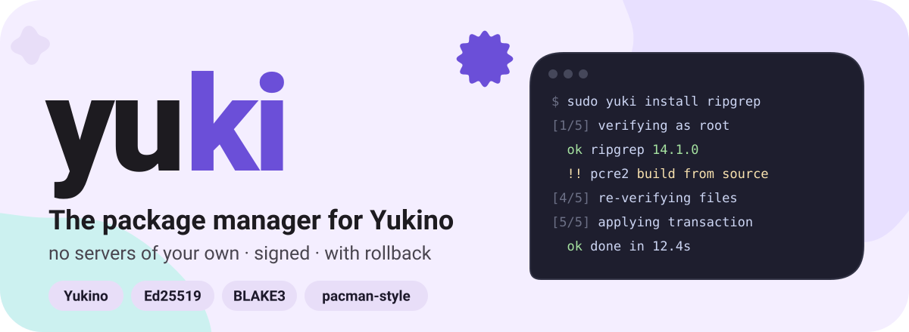</picture>

<sub>The package manager for Yukino. No servers of your own, with signatures and rollback.</sub>

<p>
<a href="#start"><picture><source media="(prefers-color-scheme: dark)" srcset="assets/en/btn-start-dark.svg"></picture></a>
<a href="TUTORIAL.md"><picture><source media="(prefers-color-scheme: dark)" srcset="assets/en/btn-tutorial-dark.svg"></picture></a>
</p>
<p>
<a href="DESIGN.md"><picture><source media="(prefers-color-scheme: dark)" srcset="assets/en/btn-security-dark.svg"></picture></a>
<a href="#commands"><picture><source media="(prefers-color-scheme: dark)" srcset="assets/en/btn-commands-dark.svg"></picture></a>
</p>

<picture><source media="(prefers-color-scheme: dark)" srcset="assets/en/status-dark.svg"></picture>

<p>
<picture><source media="(prefers-color-scheme: dark)" srcset="assets/en/stat-cmds-dark.svg">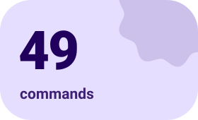</picture>
<picture><source media="(prefers-color-scheme: dark)" srcset="assets/en/stat-errors-dark.svg">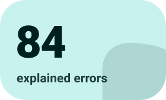</picture>
<picture><source media="(prefers-color-scheme: dark)" srcset="assets/en/stat-servers-dark.svg">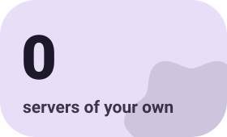</picture>
<picture><source media="(prefers-color-scheme: dark)" srcset="assets/en/stat-modes-dark.svg">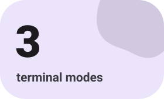</picture>
</p>

</div>

<picture><source media="(prefers-color-scheme: dark)" srcset="assets/divider-dark.svg"></picture>

<a name="about"></a>
##  What it is

**yuki** installs applications system-wide (`sudo yuki install`, like pacman) and libraries into
projects (`yuki add`, written to `yuki.toml`).
The registry is an ordinary git repository: GitHub serves the files and trust comes from signatures
and hashes, so **no servers of your own are needed**.

<p align="center">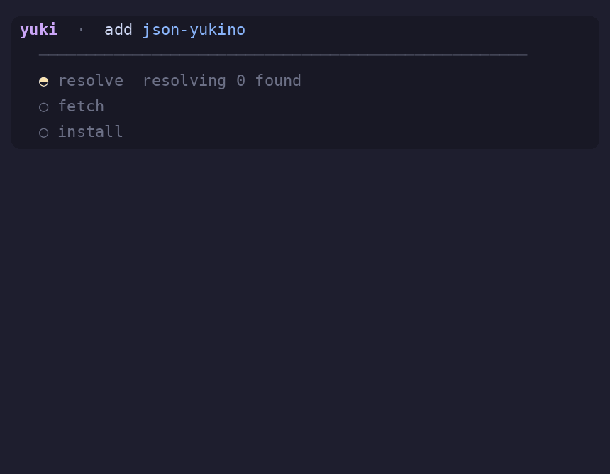</p>
<p align="center"><sub>Live panel: phases on top, the dependency tree grows below, downloads run in parallel</sub></p>

<table align="center">
<tr>
<td><picture><source media="(prefers-color-scheme: dark)" srcset="assets/en/card-signed-dark.svg">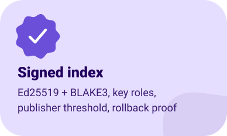</picture></td>
<td><picture><source media="(prefers-color-scheme: dark)" srcset="assets/en/card-priv-dark.svg">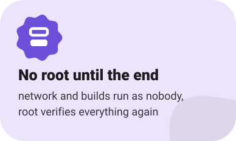</picture></td>
<td><picture><source media="(prefers-color-scheme: dark)" srcset="assets/en/card-fast-dark.svg">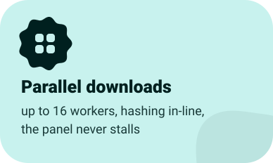</picture></td>
</tr>
<tr>
<td><picture><source media="(prefers-color-scheme: dark)" srcset="assets/en/card-tx-dark.svg">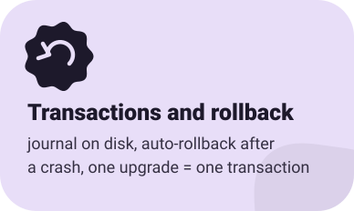</picture></td>
<td><picture><source media="(prefers-color-scheme: dark)" srcset="assets/en/card-build-dark.svg">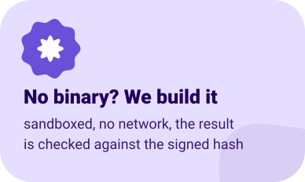</picture></td>
<td><picture><source media="(prefers-color-scheme: dark)" srcset="assets/en/card-graph-dark.svg">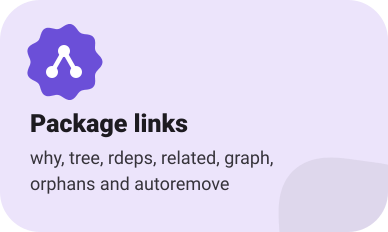</picture></td>
</tr>
</table>

<a name="start"></a>
##  Quick start

<table>
<tr><td width="96" valign="top"></td><td valign="top"><b>Build and verify</b><br>the first build compiles the sources; <code>selftest</code> then checks hashes, signatures and threads against known values</td><td valign="top" align="right"></td></tr>
</table>

```bash
cd yuki && yukino build release
sudo install -m 755 yuki-work/local/build/release/*/yuki/yuki /usr/local/bin/yuki
yuki selftest && yuki doctor
```

<table>
<tr><td width="96" valign="top"></td><td valign="top"><b>Point at an index and a trusted key</b><br>the key fingerprint is shown and asked to be confirmed</td><td valign="top" align="right"></td></tr>
</table>

```bash
sudo mkdir -p /etc/yuki
echo https://raw.githubusercontent.com/YOU/yuki-index/main | sudo tee /etc/yuki/index_url
sudo yuki keys trust main <public-key>
```

<table>
<tr><td width="96" valign="top"></td><td valign="top"><b>Use it</b><br>pacman-style flags work</td><td valign="top" align="right"></td></tr>
</table>

```bash
yuki -Ss grep                  # search
yuki -Si ripgrep               # description
sudo yuki -S ripgrep pcre2     # install, one plan and one transaction
sudo yuki -Syu                 # upgrade everything, also one transaction
sudo yuki -Rs ripgrep          # remove with unneeded dependencies
yuki related ripgrep           # what is linked to what
sudo yuki rollback             # undo the last transaction
```

<a name="how"></a>
##  How an install runs

Root appears only where the system must change, and it trusts nothing at face value.

<table>
<tr><td width="96" valign="top"></td><td valign="top"><b>The child brings index records</b><br><code>fork</code>, drop root, <code>no_new_privs</code></td><td valign="top" align="right"></td></tr>
<tr><td width="96" valign="top"></td><td valign="top"><b>Root re-verifies and builds the plan</b><br>signature, expiry, rollback, key roles, content confirmation, the "continue?" question</td><td valign="top" align="right"></td></tr>
<tr><td width="96" valign="top"></td><td valign="top"><b>Parallel download and build</b><br>thread pool, hashing in the worker; app builds run in bubblewrap without network and the result is checked against the signed hash</td><td valign="top" align="right"></td></tr>
<tr><td width="96" valign="top"></td><td valign="top"><b>Root copies to itself and checks files</b><br>BLAKE3, archive audit, path policy, safe symlinks, nobody processes killed</td><td valign="top" align="right"></td></tr>
<tr><td width="96" valign="top"></td><td valign="top"><b>A transaction with a journal</b><br>journal and backups hit the disk before the first change, auto-rollback after a crash</td><td valign="top" align="right"></td></tr>
</table>

<a name="commands"></a>
##  Commands

<code>yuki help &lt;command&gt;</code> gives examples, <code>yuki explain Y0301</code> explains any error, and typos get a suggestion.

<table>
<tr><th align="left">System (<code>sudo</code>)</th><th align="left">Look around</th><th align="left">Projects and service</th></tr>
<tr valign="top"><td>

`install` `reinstall`<br>
`uninstall [-s]` `autoremove`<br>
`upgrade` `self-update`<br>
`hold` `unhold`<br>
`rollback` `history`

</td><td>

`search` `show`<br>
`list` `info` `files` `owns`<br>
`why` `tree` `rdeps` `related`<br>
`graph [dot]` `orphans`<br>
`outdated` `check` `sys-audit`

</td><td>

`add` `remove` `update`<br>
`fetch` `audit`<br>
`keys` `theme` `pack`<br>
`index add|cosign|check|catalog`<br>
`doctor` `config` `clean` `selftest`

</td></tr>
</table>

<details><summary><b>Flags like in pacman</b></summary>

| pacman | yuki | pacman | yuki |
|---|---|---|---|
| `-S pkg` | install | `-Q` | list |
| `-Syu` | upgrade everything | `-Qi pkg` | info |
| `-Ss word` | search | `-Ql pkg` | files |
| `-Si pkg` | description | `-Qo path` | owns |
| `-R pkg` | remove | `-Qe` / `-Qd` | explicit / dependencies |
| `-Rs pkg` | with unneeded dependencies | `-Qdt` | orphans |
| `-Sc` / `-Scc` | clean the cache | `-Qu` / `-Qk` | outdated / check files |

</details>

<a name="security"></a>
##  Security

| Threat | What stops it |
|---|---|
| Swapped archive or index | BLAKE3 + Ed25519, re-verified as root |
| Rollback and a frozen index | `seq`, `expires`, local `seen` state |
| Leaked renewal key | the `renewer` role cannot sign release content |
| Leaked publisher key | publisher threshold (`publish_threshold`), `cosign`, rotation and revocation |
| Malicious archive | audit before unpack, path policy, symlink checks, size limits |
| Network or build compromise | privilege separation, bubblewrap, signed result hash |
| Power loss mid-install | journal on disk, auto-rollback on the next run |

The full story, including **what is not protected**, is in [`DESIGN.md`](DESIGN.md) (Russian).

<a name="look"></a>
##  How it looks

<table>
<tr>
<td>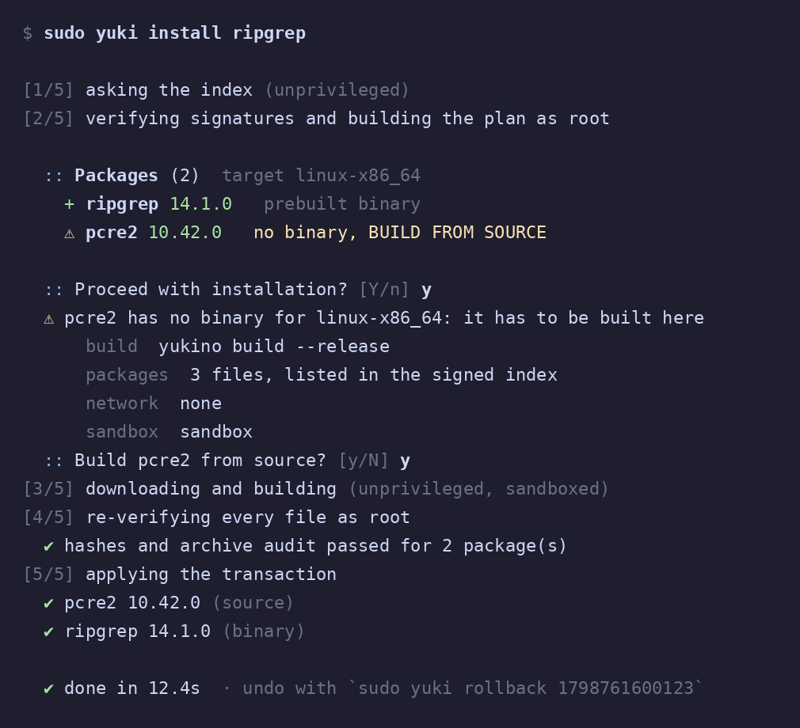sudo yuki install</code>"></td>
<td>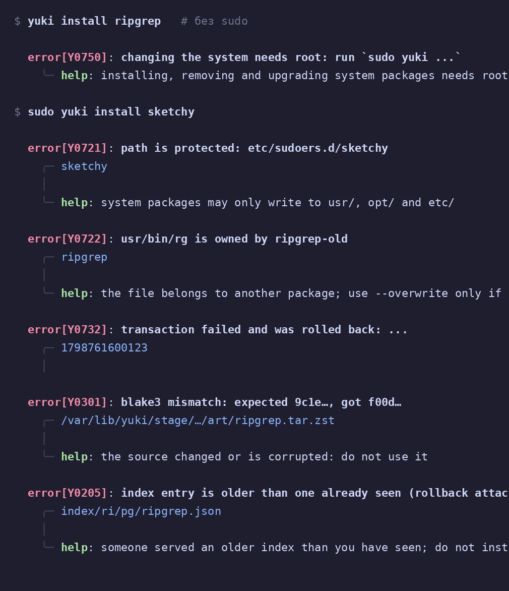help</code> and a <code>yuki explain</code> link"></td>
</tr>
<tr>
<td align="center"><sub><code>sudo yuki install</code></sub></td>
<td align="center"><sub>every error carries <code>help</code> and a <code>yuki explain</code> link</sub></td>
</tr>
</table>

<p align="center">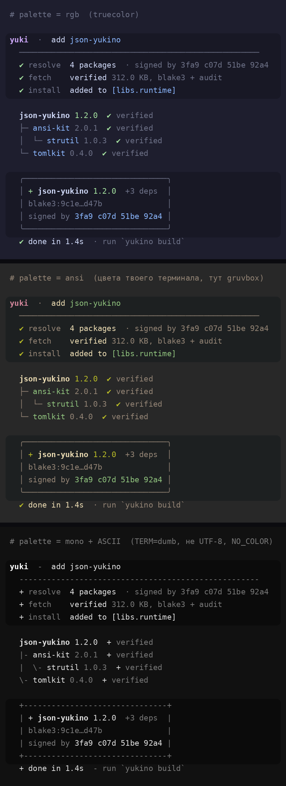palette = "ansi"</code>) and ASCII"></p>
<p align="center"><sub>One result in three modes: truecolor, your terminal colors (<code>palette = "ansi"</code>) and ASCII</sub></p>

A single theme, tunable through `theme.toml`: colors, symbols, animation. Everything degrades on
its own: truecolor → 256 → 16 → no color, UTF-8 → ASCII, a live terminal → a plain log for CI. `NO_COLOR=1` works.

<p align="center"></p>

```toml
# ~/.config/yuki/theme.toml  or  /etc/yuki/theme.toml
palette = "ansi"            # "rgb" | "ansi" (terminal colors) | "mono"

[colors]
accent = "ansi:cyan"
bad    = "#f38ba8+bold"

[style]
animation = true
bar_gradient = true
```

> The pictures illustrate what the code does rather than real runs. Package names, hashes and numbers in them are invented.

<a name="index"></a>
##  Your own index in an evening

<table>
<tr><td width="96" valign="top"></td><td valign="top"><b>Repository</b><br>copy <code>yuki-index-template/</code>, turn on branch protection for <code>main</code> and CODEOWNERS</td><td valign="top" align="right"></td></tr>
<tr><td width="96" valign="top"></td><td valign="top"><b>Keys</b><br><code>yuki keys gen main</code>, the public part into <code>keys/trusted_keys</code>, the secret stays offline</td><td valign="top" align="right"></td></tr>
<tr><td width="96" valign="top"></td><td valign="top"><b>Package</b><br><code>yuki pack</code> builds the archive and runs the policy checks, the release is published on GitHub</td><td valign="top" align="right"></td></tr>
<tr><td width="96" valign="top"></td><td valign="top"><b>Record</b><br><code>yuki index add release.json main</code> downloads, verifies and signs; a second publisher runs <code>cosign</code></td><td valign="top" align="right"></td></tr>
<tr><td width="96" valign="top"></td><td valign="top"><b>CI</b><br><code>yuki index check download</code> on every PR and monthly key renewal with the <code>renewer</code> key</td><td valign="top" align="right"></td></tr>
</table>

Step by step: [`TUTORIAL.md`](TUTORIAL.md) (Russian). Repository template: [`yuki-index-template/`](yuki-index-template/).

<a name="faq"></a>
##  FAQ

<details><summary><b>Do I need my own servers?</b></summary>
No. The index lives in a git repository, the client fetches files over HTTPS (you can list several mirrors) and verifies the signatures itself.
</details>

<details><summary><b>Why is system installation only via sudo?</b></summary>
Installing changes the system. Networking and building run without privileges, root re-verifies everything and applies a single journaled transaction.
</details>

<details><summary><b>What if there is no prebuilt binary?</b></summary>
For applications yuki either installs a signed prebuilt binary or builds from source: the build runs in bubblewrap (no network, read-only root, only the build directory writable), and the build command, the file list and the signed result hash are shown and require your consent. In scripts the flag is <code>--allow-build</code>. Without bubblewrap the build is refused until the admin explicitly allows unsandboxed builds.
</details>

<details><summary><b>How do libraries differ?</b></summary>
A <code>kind = "lib"</code> entry is source-only: no prebuilt library artifacts are accepted anywhere, and libraries use the C FFI. If the source archive contains a <code>build.ykn</code> script, its contents are displayed and it runs only after explicit confirmation. Library builds skip the heavy app sandbox and network rules.
</details>

<details><summary><b>How does yuki update itself?</b></summary>
<code>sudo yuki self-update</code>. The new binary must be able to start, otherwise the update rolls back.
</details>

<details><summary><b>A key leaked. What now?</b></summary>
Sign a <code>rotation.json</code> revoking it with enough keys and run <code>sudo yuki keys refresh</code>. A revoked key never comes back.
</details>

<details><summary><b>Does this work?</b></summary>
Yes, as verified: both source trees compile with the Yukino toolchain, <code>yuki selftest</code> passes (hashing, signing, verification, threads, files) and the language server reports no diagnostics on the sources. What the security model deliberately does not cover is listed in <code>DESIGN.md</code>.
</details>

<picture><source media="(prefers-color-scheme: dark)" srcset="assets/divider-dark.svg"></picture>

<p align="center"><sub>yuki · for <a href="https://github.com/yukitsuri/yukino">Yukino</a> · <a href="TUTORIAL.md">tutorial</a> · <a href="DESIGN.md">security model</a> (Russian)</sub></p>
